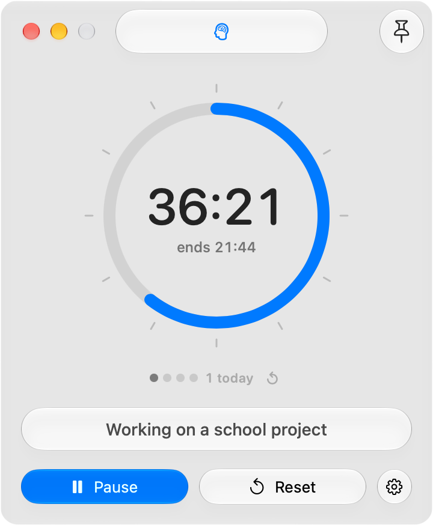

# kyklos

kyklos (KEE-klos, Greek for both *circle* and *cycle*) is a free, minimal Pomodoro timer for macOS, in its own window and in the menu bar. It is built to keep a
wandering mind on one thing at a time.

kyklos started as a fork of [Cloud](https://github.com/YYUUGGOO/Cloud) by David and has since been almost entirely rewritten.

<p align="center">
  <picture>
    <source media="(prefers-color-scheme: dark)" srcset=".github/screenshot-dark.png">
    
  </picture>
</p>

## Features

- Focus, Short Break and Long Break, with a long break after every 4 focus sessions (2 to 8, your choice)
- When time is up, the timer counts the overtime and offers to start the next phase with one click
- A "What are you working on?" line, shown in the window and next to the time in the menu bar
- A 60-minute dial: the coloured arc is the time left, so 25 minutes always looks like 25 minutes, plus the time it will end
- Drag the dial to set the length (it clicks at each minute on a Force Touch trackpad), scroll over it, or click the time and type it
- Today's finished focus sessions, shown as dots, with a button to reset them
- Accurate to the system clock: keeps counting through sleep and never drifts
- A notification and an alarm when time is up, with the alarm ringing again every minute for up to 10 minutes
- A choice of alarm sounds, including low, soft ones, or your own: any audio file up to 30 seconds
- A global shortcut to start or pause from any app: ⌃⌥K, or one you pick
- Optional mouse mode: click the dial to start or pause, and triple-click it to reset
- Optional Zen Mode that hides the phase switcher while the timer is running
- Optional Minimal Mode: a small floating pill with the time, the task and one button, shown during a session or all the time
- A window that can stay on top of other windows
- Light and Dark Mode, following your Mac or set by hand
- Built with Liquid Glass on macOS 26 and later; older versions get standard controls
- An app icon that follows macOS 26's Dark, Clear and Tinted icon styles
- Launch at Login support
- A native Mac app, light on resources: about 75 MB of memory and well under 1% of the CPU
- No ads and no data collection

## Download

kyklos needs macOS 14 or later. It's made and tested on macOS 27; reports from older versions are welcome.

1. Download `kyklos.zip` from the [latest release](../../releases/latest) and unzip it (Safari does this for you),
   then move kyklos to Applications.
2. Open it. macOS will say it can't check kyklos for malicious software, because the app isn't notarised by Apple
   (that takes a paid developer account). Click Done.
3. Open System Settings → Privacy & Security, scroll down to the message about kyklos, and click Open Anyway.

You only need to do this once.

## Build from source

You need Xcode.

1. Open `Timer.xcodeproj` in Xcode.
2. Allow Xcode to resolve the Swift package dependency.
3. Select the `Timer` scheme and build or run the app.

No Apple developer account is needed: the app is signed to run locally. To build from the command line:

```sh
xcodebuild -project Timer.xcodeproj -scheme Timer -configuration Release -derivedDataPath build build
```

The app ends up in `build/Build/Products/Release/kyklos.app`.

## Dependency

- [LaunchAtLogin-Modern](https://github.com/sindresorhus/LaunchAtLogin-Modern)

## Support

kyklos is free and will stay free. If it helps you, you can [buy me a coffee on Ko-fi](https://ko-fi.com/yiorgosp).

## License

kyklos is licensed under the GNU General Public License v3.0. It still contains parts of Cloud (some code and the
"Classic" alarm sound), which is licensed under the same terms; those parts are © David. The other alarm sounds
are synthesized by `tools/alarm-sounds.swift`.
